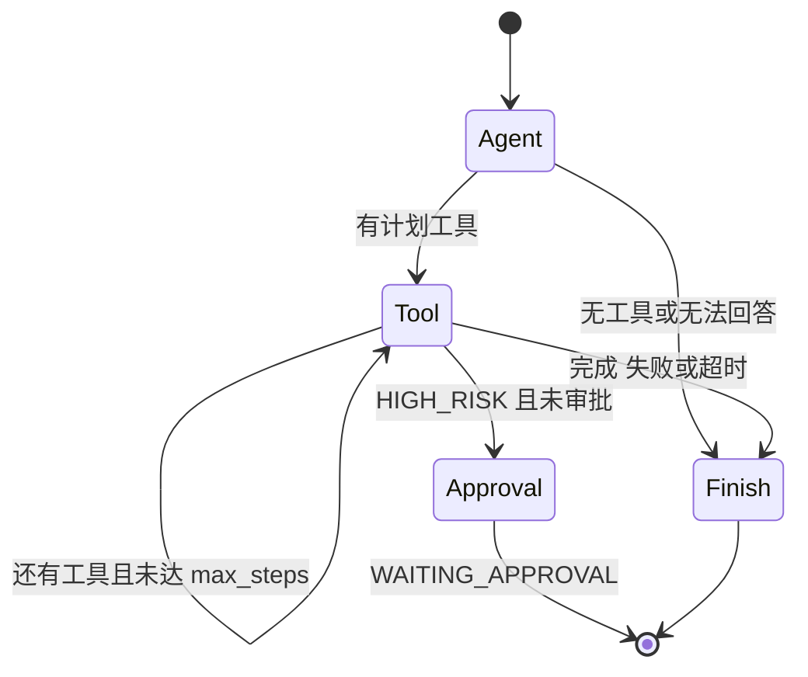

# Agent 工作流

## LangGraph 执行路径

Agent 节点使用规则 Planner 或 OpenAI-compatible Planner 生成 ToolCall。规则 Planner 用于确定性测试和演示；OpenAI Planner 使用每个 Tool 的 JSON Schema 做 Function Calling。

Tool 节点在调用前保存 Checkpoint，解析前序工具引用，执行 schema 校验，并施加 Timeout 和有限重试。写操作先进入 Approval 节点。批准后从最近 Checkpoint 恢复，修改后的 payload 会重新校验。失败任务可由 `/resume` 从最近状态继续。

## 多工具数据流

差旅 Demo 首先调用 Knowledge Tool，得到 `facts.daily_total_limit`。Calculator Tool 的 `left` 参数引用 `$tool.knowledge.facts.daily_total_limit`，工作流在调用前解析该引用，因此计算数据来自真实前序结果，不是 Planner 预填的答案。

## Checkpoint 和 Memory

Checkpoint 保存完整可序列化工作流状态，用于审批和故障恢复。Short Term Memory 保存当前会话的最近任务和工具结果。Long Term Memory 只接受用户明确表达的偏好，并拒绝寒暄、凭证和普通工具噪声。
