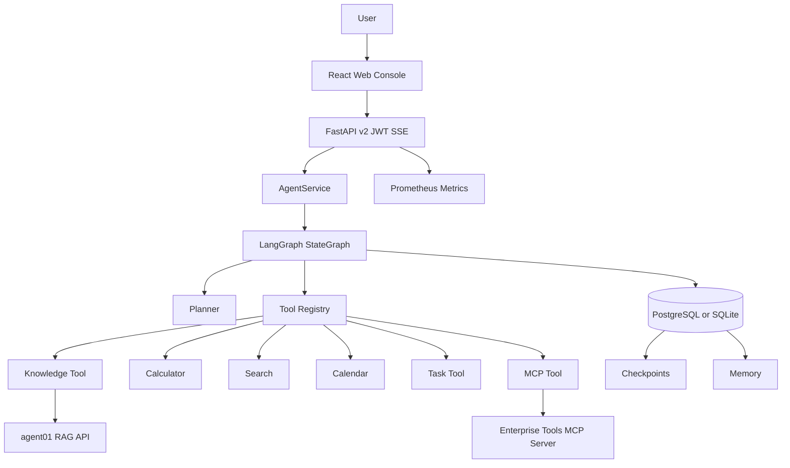

# 系统架构

## 组件关系

FastAPI 只处理协议、身份、校验、SSE 和 request ID。AgentService 负责创建或恢复任务。LangGraph 显式定义节点与条件边。Tool Registry 统一完成 schema 校验、超时、有限重试和错误转换。Repository 层保存任务状态、执行步骤、工具调用、Checkpoint、LLM 调用、审计和记忆。

## 状态和隔离

每个任务都有独立的 `tenant_id`、`created_by`、`session_id`、`task_id` 和 `request_id`。v2 API 读取和审批任务时必须匹配 JWT 中的 `tenant_id`；请求体中的身份字段不能改变真实用户。工作流状态、Checkpoint、Memory 和审计均按租户隔离。

任务状态为 `CREATED`、`RUNNING`、`WAITING_TOOL`、`WAITING_APPROVAL`、`COMPLETED`、`FAILED` 或 `TIMEOUT`。`max_steps` 是硬上限，达到上限后工作流进入 `FAILED`，不会继续调用工具。

## 安全边界

- Pydantic 校验所有 API 与 Tool 参数。
- Calculator 只接受限定操作，不执行任意表达式。
- Task Tool 是 HIGH_RISK，审批前不产生副作用，审批后使用幂等键。
- RAG、Search 与 MCP 返回内容标记为不可信数据，不能成为系统指令。
- 配置只从环境变量加载；结构化日志按敏感键和值模式脱敏。
