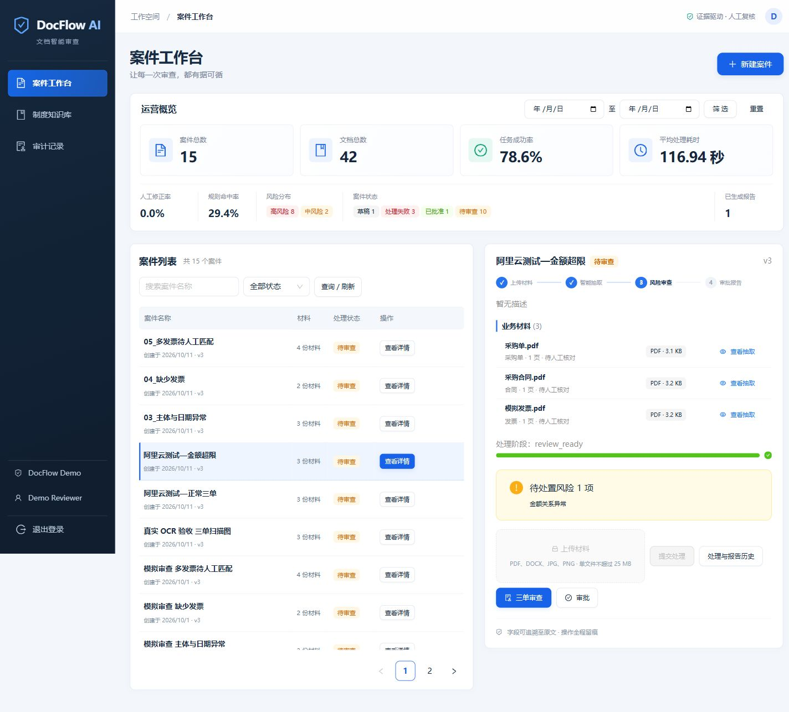

# DocFlow AI

DocFlow AI 是面向合同、采购单和发票的多模态文档审查平台。当前版本已形成第一至第五阶段的首条可用审查闭环：租户隔离、登录、案件、安全上传、幂等任务、PDF/DOCX/图片解析、文档分类、版本化字段抽取、原文证据、三单关联、确定性风险规则、人工字段修正、风险处置、版本化制度知识库、制度引用、案件审批、异步固化报告、SSE 事件、审计和 Web 工作台。

当前代码位于 `Python-Basics/agent03`，独立安装和运行，不依赖 `agent01` 或 `agent02`。从仓库根目录操作前请先进入 `agent03`。这是可演示的开发项目，不是已完成生产安全与真实业务质量验收的上线系统。



截图为虚构演示案件。密钥、本地数据库、上传文件、依赖缓存与临时产物均不纳入版本控制；使用仓库中的环境变量示例配置自己的本地环境。主仓库的 `DocFlow AI CI` 工作流只验证此项目的后端测试与前端测试/构建，不需要云端密钥。

## 本地快速启动

需要 Python 3.12 或 3.13，以及 Node.js 22 和 pnpm。

```powershell
python -m venv .venv
.\.venv\Scripts\python.exe -m pip install -e ".[dev]"
Copy-Item .env.example .env
.\.venv\Scripts\python.exe -m alembic upgrade head
.\.venv\Scripts\python.exe -m app.main
```

另一个终端启动前端：

```powershell
pnpm --dir web install
pnpm --dir web dev
```

打开 `http://127.0.0.1:5173`，演示账号为 `demo@docflow.local`，密码为 `Demo123!`。本地模式使用 SQLite、文件系统、Fake 病毒扫描和 eager Worker，不需要 Docker 或模型 API Key。

## Docker Compose

```powershell
Copy-Item .env.example .env
docker-compose up --build
```

Compose 启动 PostgreSQL、Redis、MinIO、API、Celery Worker 和 Web，入口为 `http://127.0.0.1:8083`。首次启动由 API 容器执行 Alembic 迁移。部署到非开发环境前必须修改 `SECRET_KEY`、数据库密码和 MinIO 凭据，并接入真实病毒扫描适配器。

## 验证命令

```powershell
.\.venv\Scripts\python.exe -m pytest -q
.\.venv\Scripts\ruff.exe check .
.\.venv\Scripts\python.exe -m pytest --cov=app --cov-report=term-missing
pnpm --dir web typecheck
pnpm --dir web build
docker-compose config
```

## 主要接口

- `POST /api/v1/auth/login`：登录并签发当前租户 Token。
- `POST /api/v1/auth/select-tenant`：多租户用户选择租户。
- `GET /api/v1/auth/me`：当前身份与角色。
- `POST|GET /api/v1/cases`：创建和查询案件。
- `POST /api/v1/cases/{id}/documents`：安全上传文档。
- `POST /api/v1/cases/{id}/submit`：使用 `Idempotency-Key` 提交处理。
- `GET /api/v1/documents/{id}/extraction`：查看最新抽取版本、规范化字段和页码坐标证据。
- `GET /api/v1/cases/{id}/comparison`：查看合同、采购单和发票的字段对照。
- `GET /api/v1/cases/{id}/risks`：查看最新规则批次产生的风险。
- `POST /api/v1/cases/{id}/review`：以追加版本方式重新执行确定性规则。
- `PATCH /api/v1/fields/{id}`：携带 `expected_version` 与理由修正字段，并触发案件规则局部重算。
- `POST /api/v1/risks/{id}/resolve`：携带 `expected_version`、处置结果与理由处理风险。
- `POST /api/v1/policies`：管理员上传带版本和有效期的 PDF/DOCX 制度文件。
- `GET /api/v1/policies`：查看当前租户的制度版本。
- `GET /api/v1/policies/search`：按业务日期执行租户级混合检索并返回可追踪引用。
- `POST /api/v1/cases/{id}/approvals`：使用案件版本锁进行批准或驳回；未处置高风险会阻断批准。
- `POST /api/v1/cases/{id}/reports`：使用 `Idempotency-Key` 异步生成已批准案件的固化报告。
- `GET /api/v1/reports/{id}`：查询报告生成状态、内容哈希和版本。
- `GET /api/v1/reports/{id}/download`：下载租户隔离、内容哈希校验的不可变 PDF 报告。
- `GET /api/v1/dashboard/summary`：按可选日期范围汇总案件、任务、人工修正、规则、风险、审批和报告指标。
- `GET /api/v1/jobs/{id}/events`：支持 `Last-Event-ID` 的 SSE 进度。
- `GET /health/live`、`GET /health/ready`、`GET /metrics`：运行保障。

## 文档智能能力

- 原生 PDF 使用 PyMuPDF 提取页面、文本块和坐标。
- DOCX 读取段落与表格，并保留可追踪的逻辑块。
- 图片会校验真实性和尺寸，目前使用明确标记的 Fake OCR 回退结果。
- 合同、采购单和发票通过可测试的确定性特征分类。
- 合同号、订单号、发票号、主体、金额、税额和日期按文档 Schema 抽取并规范化。
- 每个字段保存抽取版本、置信度、页码、坐标、原文片段和文本哈希。
- 自动关联同一案件内的合同、采购单和发票，保留每次关联批次。
- 检查三单完整性、交易主体一致性、金额层级与日期顺序；风险结论保留规则版本、输入和证据引用。
- 人工修正保留原值、新值、操作者、理由和版本；陈旧版本写入返回 409，避免多人覆盖。
- 风险支持“问题已解决”和“接受风险”两种处置，处置前后状态进入审计日志。
- 制度按租户、标题、版本、生效日和失效日保存；同名制度检索时只使用目标日期下最新的有效版本。
- 本地检索组合中文词项匹配与稳定哈希向量相似度，风险固化制度版本、片段、页码和检索分数。
- 制度内容始终按不可信数据处理；文本中的指令不会改变规则结果或系统行为。
- 审批保存决定、理由、操作者和所依据的案件版本；批准后案件进入锁定状态。
- 报告在 eager 模式由后台任务生成，在 Compose 模式交给 Celery；PyMuPDF Provider 将转义后的审查快照排版为 A4 PDF，文件进入对象存储并保存 SHA-256。
- 报告中的用户和文档文本经过 HTML 转义，下载响应提供内容哈希 ETag。
- 运营仪表盘只聚合同一租户的数据，并按案件最新规则批次统计风险，避免局部重算重复计数。

## 工作台完善（2026-10-01）

- 案件工作台支持按名称和状态筛选、每页 12 条分页；当前页案件、最新任务和报告由批量接口加载。
- 刷新后恢复处理进度、失败原因及报告下载入口；多任务和报告自动更新状态。
- 草稿文档支持确认删除；失败案件可重新提交，新任务保留原失败尝试的历史和 Trace。
- 任务历史保留事件序号、阶段、时间和失败信息；跨租户历史和 SSE 在返回响应前校验资源归属。
- 失败报告支持同一记录重试，生成使用数据库状态抢占，下载前校验 SHA-256；旧 HTML 报告兼容下载。
- 管理员审计页支持操作类型筛选、分页、变更前后值和追踪编号；普通用户禁止访问。
- 已审批案件禁止手动规则重算和风险处置；过期风险不能继续处置。
- 登录失效自动返回登录页；窄屏导航、日期筛选及操作按钮支持换行。

新增接口：`GET /api/v1/workbench`、`GET /api/v1/cases/{id}/jobs`、`GET /api/v1/cases/{id}/reports`、`GET /api/v1/jobs/{id}/history`、`GET /api/v1/audit-logs`、`POST /api/v1/reports/{id}/retry`。

完善版的实际范围为本地可用的核心审查工作台。真实 OCR、生产病毒扫描、真实模型和向量库、复杂多单据匹配、用户管理及 Docker 运行验收仍未完成，不能将其视为生产上线验收。

## 模拟文档审查验收（2026-10-01）

桌面 `模拟文件` 目录提供 15 份明确标注虚构用途的中文 PDF，按五个场景分别上传到五个案件：正常三单、金额超限、主体与日期异常、缺少发票、多发票待人工匹配。目录中的 `使用说明.txt` 和 `审查测试清单.json` 记录预期结果。

实际 HTTP 验收结果保存在 `data/demo-review/verification.json`。五组风险均与预期一致，正常案件获批并生成 PDF 报告，另外四组批准请求返回 409。对应 PDF 已作为固定回归材料放入 `tests/fixtures/demo`，测试不依赖桌面目录。

- 多份同类文档产生 `AMBIGUOUS_DOCUMENT_SET` 高风险；停止自动关联与三单比较，不再覆盖选择最后一份文档。人工多单匹配尚未实现。
- 数据库写入失败先回滚再保存失败事件，避免任务永久停留在处理中；结构化日志保留异常堆栈。
- `/health/ready` 检查模型所需表与字段；缺失时返回 503 和 `schema_outdated`，需先执行数据库迁移。现有本地数据库已备份并升级。

生成新样本需要 `reportlab`（可安装 `.[demo]`）；生成器拒绝覆盖已有输出。验收脚本会创建案件、提交材料、尝试审批，并为正常样本生成报告，请只在开发演示环境运行。

```powershell
.\.venv\Scripts\python.exe scripts/create_demo_documents.py --output ./data/new-demo-documents
.\.venv\Scripts\python.exe scripts/review_demo_documents.py --root ./data/new-demo-documents --result ./data/demo-review/new-verification.json
```

## 真实 OCR、模型抽取与评测（2026-10-11）

可选安装 `.[ocr]` 后设置 `OCR_BACKEND=rapidocr`，即可识别图片和扫描 PDF；已通过真实中文 OCR 三单端到端测试。默认轻量模式仍显式使用 Fake OCR，生产配置禁止 Fake OCR。

抽取可选 `deterministic`、`ollama`、`cloud`。模型结果必须通过严格结构与原文证据校验，模型不能替代确定性审批和风险规则。云端配置会发送文档文本并可能收费，未配置凭据时不启用，也不静默回退。

新增迁移 `20261011_0007` 保存处理来源、耗时与用量；已有数据库先备份再升级。评测脚本输出逐样本结果和分组指标。配置、运行命令和未验收项见 [AI 补齐记录](docs/ai-milestone.md)。

## 当前边界

云端供应商已选择阿里云百炼，提供 `.env.aliyun.example` 与本地无网络配置检查。配置步骤见 [阿里云接入说明](docs/aliyun-setup.md)。本机已启用 Qwen-Plus，已留存真实云端抽取记录；用户已通过五组虚构材料的页面风险核对及金额超限审批拦截测试。这不等同于独立真实业务数据集上的质量验收。

真实 OCR 已可选启用；默认轻量演示仍使用 Fake OCR。真实云端模型已接通，但尚未完成更大规模独立样本的质量验收。当前三单关联限定为同一案件内每种类型一份文档；制度检索采用无需外部 Key 的本地确定性实现，尚未接入生产级向量数据库与重排模型。PDF 报告已具备基础 A4 分页版式，品牌页眉、电子签章和复杂表格断页仍需增强。复杂表格、多份单据匹配、细粒度成本统计和趋势图仍属于后续阶段。任何生产环境都禁止使用 eager 队列、Fake OCR 和 Fake 病毒扫描。

## 审查闭环加固（2026-10-22）

- 比对接口增加 `match_status` 和候选文件：区分已关联、真正缺失、多份待匹配与抽取未就绪；多份单据仍不自动选择或汇总。
- 审批只检查最新审查轮次的未处置高风险；旧风险保留供审计，不再误拦截已修正案件。没有审查结果时拒绝批准；重新审查不会沿用旧轮次的风险接受。
- 工作台增加中文字段、风险名称、审批错误及追踪编号；取消固定 85% 的概率展示，保留后台原始分数。对话框按钮使用中文。
- 新增前端组件/展示回归测试：在 `web` 中运行 `npm test`；后端测试使用隔离数据库，不会调用收费模型或审批工作台案件。

本轮范围和测试记录见 [闭环加固记录](docs/workbench-hardening-20261022.md)。人工多单选择/合计分摊、生产级病毒扫描、Docker 启动验收仍未完成。

## 工作台视觉改版（2026-10-26）

已按确认的预览改为深色导航、真实运营统计、案件列表与选中详情双栏；窄屏自动改为上下布局。上传、抽取核对、修正、三单审查、审批、报告、历史、制度库和审计入口均保留，权限与状态约束不变。本轮前端 14 项测试、生产构建及后端 92 项回归通过。界面验收未额外调用收费模型，也未审批或删除原有案件。

功能对照和实际截图见 [视觉改版记录](docs/workbench-design-20261026.md)。

